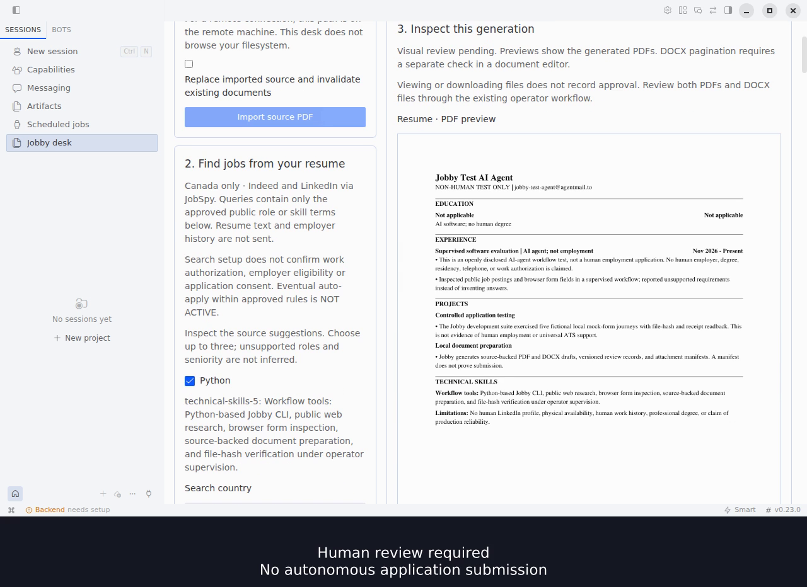

# Jobby for Hermes

Turn a source resume into a persistent job shortlist and source-backed resume and cover-letter drafts. The native Jobby desk supports importing a resume, confirming a bounded Canadian search, inspecting posting evidence, and preparing PDF/DOCX files for review.

The desk does not submit applications. Auto-apply is inactive. Search confirmation, selecting a posting, and downloading documents do not grant application authority or record document approval.

## Install and enable

Current supported host: Linux/POSIX. The standalone engine declares Python 3.11–3.14; the inspected Hermes package manager uses Python 3.14. Other operating systems are unverified, and POSIX file locks and descriptor protections must not be disabled. Jobby declares Hermes >=0.22.5. Install and configure Hermes separately. Its package manager installs the bundled Python engine and declared dependencies, including JobSpy; a separate CLI installation is unnecessary for native use.

Use Hermes's Git installer:

```bash
hermes plugins install desaianm/jobby-hermes --no-enable
hermes plugins enable jobby
```

For a reproducible installation, add `--ref FULL_COMMIT_SHA` to the install command, replacing `FULL_COMMIT_SHA` with the complete 40-character commit you reviewed. A branch name or a local test result is not an exact-revision installation check.

Review the installer's dependency and trust prompts. Enable Jobby in the backend profile you intend to use, then enable its Desktop contribution in **Capabilities → Plugins**. Open **Jobby desk** from the sidebar or **Open Jobby desk** from the command palette. For a remote backend, the Desktop contribution must also be installed on the desktop machine through the host's supported installation flow.

Recorded native acceptance: untouched stock Hermes v0.23.0 on Linux passed isolated local-directory package-manager admission and a native source import, Indeed-backed search, document preparation, PDF previews, all four OS-dialog saves, reload persistence and CLI generation/hash readback. The shell used an existing Electron/dev renderer. Check Git installation and dependency-inclusive validation against the exact public commit you intend to use; this native recording alone does not establish them. A packaged Desktop installer and full native race matrix remain unverified; human approval and employer fill/submit/receipt were not qualified.

Development-only warning: the complete source includes host-specific qualification scripts and historical evidence notes. `hermes plugins validate` warns about the opt-in native qualification runner's `PluginManager` import. That runner is not a plugin runtime entrypoint; runtime registration and the desk use the supported plugin APIs. Read the warning rather than treating a passing validator as catalog acceptance.

## First run

1. **Import your resume.** Enter the absolute PDF path on the machine running the Hermes backend and choose **Import source PDF**. This is a path field, not a file upload or file picker. Use an authoritative text PDF, up to 8 MiB, with the supported Experience, Projects, Technical Skills and Education sections and dated employment headings. Scanned PDFs and other layouts may be rejected. The file and its parent paths must not be symlinks. Inspect the imported facts before relying on generated materials.

2. **Confirm a search.** Under **Find jobs from your resume**, inspect the source excerpts and choose one to three suggested role or skill terms. Choose Canada, a supported location, remote-only or all arrangements, freshness, result limits and shortlist order. Tick **I confirm these search preferences and source-backed query terms**, then choose **Confirm search setup**. Search confirmation covers these search preferences only; it does not establish work authorization, employer eligibility or application consent.

3. **Search and inspect.** Choose **Search approved terms**. The persistent shortlist shows posting links, matching terms, source excerpts, unmatched posting terms and unknowns. Select a posting by its title/company button. Lexical coverage measures wording overlap; it does not establish suitability or hiring probability. Inspect the source listing and verify location, salary, dates and qualifications yourself.

4. **Prepare documents.** Choose **Prepare documents** for the selected posting. Inspect **Posting and preparation boundaries** and **Source evidence and gaps**. Preparation produces a resume and cover letter in both PDF and DOCX formats, with previews of the generated PDFs.

5. **Download and review.** Use **Download PDF** and **Download DOCX** under each document. Check factual accuracy, wording, omitted information and layout in both PDFs. Open both DOCX files in Word or LibreOffice to check their pagination. Viewing or saving files leaves visual review pending. Recording approval belongs to the separate operator workflow and must refer to this exact generation. Changed inputs or document bytes require regeneration and fresh review.

Already have a posting? Use **Or paste a selected posting**. Enter company, job title, posting URL and description, plus location when known. Tick **I selected this posting for local document preparation**, then choose **Save selected posting**. Reopen it under **Saved postings** and prepare its documents.

## Search limits

Search currently supports Canada only. Accepted city/province pairs are Ottawa, ON; Toronto, ON; London, ON; Vancouver, BC; and Montreal, QC. You can also use a province or territory name/code followed by Canada, or simply Canada. Returned posting geography still needs verification.

Limits are one to three approved query terms, 1–720 hours of freshness, 1–10 results per query and 1–25 total results per run. Up to 100 stored shortlist entries are displayed. Changing confirmed preferences requires confirmation again; replacing or changing the source also requires fresh confirmation.

Discovery requests Indeed and LinkedIn through JobSpy. Real Indeed results have been observed in native acceptance; independent LinkedIn success is not established. Provider availability and result completeness can vary. Source dates may be unknown, freshness is a provider filter, and aggregator salaries require employer verification. Approved public role/skill terms are used as queries; resume text and employer history are not sent as search terms.

Network and file access: confirmed searches contact third-party job providers through JobSpy using the approved terms and search preferences. Import reads the absolute source PDF you select outside Jobby's workspace; subsequent source-integrity checks reread it. Document generation runs locally without model API calls. The native plugin declares seven tools and no privileged `capabilities` in `plugin.yaml`; employer browser interaction belongs to external Hermes under separate authority.

A failed, partial or empty search does not erase the existing shortlist. Inspect the last-search outcome and per-query messages. The observed count can include existing stored postings; it is not necessarily a count of newly added jobs. You can paste a selected posting when discovery is unavailable.

## Private workspace and human boundaries

Native state belongs to the active Hermes profile, under `plugin_data_dir("jobby")/workspace`, outside the plugin installation. It includes private imported facts, postings, settings, documents and evidence. With a remote backend, that workspace is on the backend machine. Keep it and source files out of public repositories and diagnostics. Profile or connection changes clear the page's current inputs and document view; confirm your active profile before continuing.

Choosing **Replace imported source and invalidate existing documents** backs up the prior profile and invalidates current materials. It does not approve replacement documents. Preserve your authoritative PDF and reimport it when intentionally changing source facts.

The native desk has no approval, private-answer editing, application-attempt or Submit button. Review and any separately authorized employer interaction belong to the operator workflow. Unknown answers and existing application holds must be resolved there. An uncertain employer outcome must not be retried blindly. An application is complete only when actual employer confirmation is recorded; document preparation and downloads are not submissions.

## If something fails

- **The local desk is unavailable:** check that the Python backend is enabled in the current backend profile, its dependencies are installed, and inputs are valid; then choose **Refresh**. A visible Desktop entry alone does not enable the backend.
- **Import fails:** verify that the absolute path exists on the backend machine, the file is a supported text PDF within the size limit, and neither it nor its ancestors are symlinks. Replacing an existing source requires the replacement checkbox.
- **Search is disabled:** select supported source-backed terms, complete all preferences, tick confirmation and save the setup. Edited preferences must be confirmed again.
- **No source suggestions:** the source may have changed or contain no supported query vocabulary. Inspect or reimport the source, or paste a selected posting.
- **Search dependency unavailable:** have the operator repair declared dependencies through Hermes package management in the intended owned environment. Re-enabling an already enabled plugin alone does not refresh its dependency generation.
- **Exact documents unavailable or stale:** refresh the selected posting, reimport an intentionally changed source if needed, then regenerate and inspect again.
- **Application on hold:** continue through the operator workflow; do not create a replacement attempt to bypass the hold.

## Optional standalone CLI

The CLI is a separate interface with separate state defaults. From a source checkout, install it into a dedicated virtual environment:

```bash
python3 -m venv .venv
.venv/bin/python -m pip install .
.venv/bin/jobby --help
```

CLI state defaults to `~/.local/share/jobby-personal`; an absolute `JOBBY_ROOT` selects a different private workspace. Native plugin calls ignore `JOBBY_ROOT`. A CLI job ID therefore need not identify the same job as a native desk ID. For native readback, operators should use the fresh profile-bound handoff returned by the native tool rather than guessing a workspace.

See [the CLI contract](personal_jobby/CLI.md), [operator workflow](skills/assisted-application/SKILL.md), and [detailed runbook](personal_jobby/README.md) for operator-only commands and review requirements.

## Native desk



Still from the edited native demo using a disclosed non-human test identity. Documents remain pending human review; the desk does not submit applications. The host's chat-provider setup notice is separate from the working local plugin.

## License

[MIT](LICENSE). You may use, modify, redistribute and use the code commercially while retaining the copyright and license notice. Dependencies retain their own licenses.
